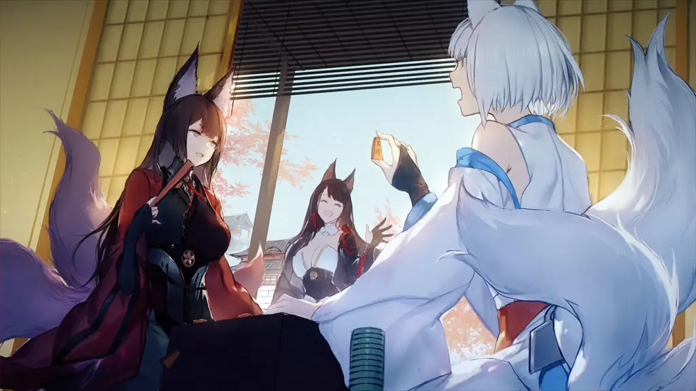
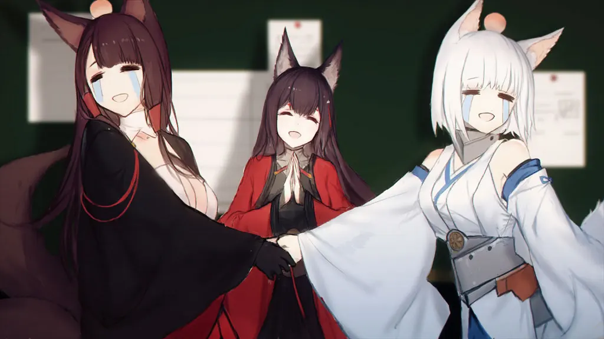
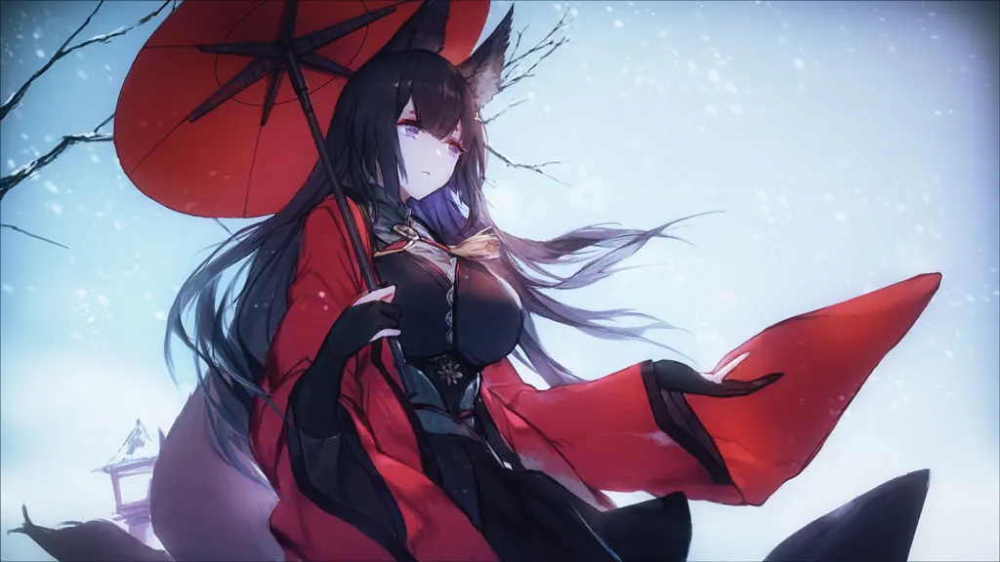
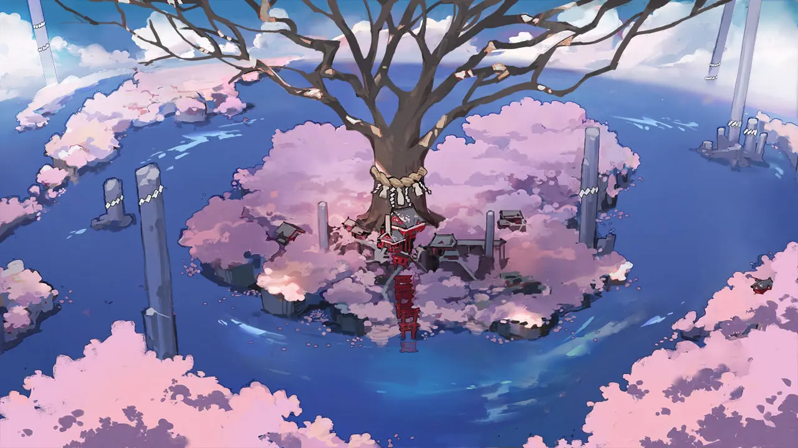
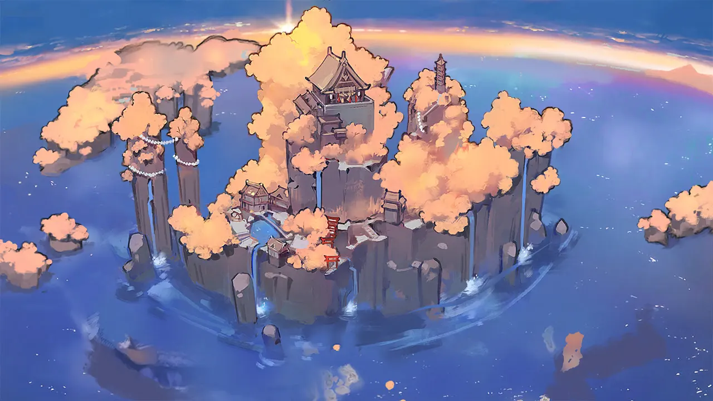

 <!-- начало главы -->

Последовательность













 <!-- конец главы -->

 <!-- начало главы -->

Воспоминание 1




 <!-- конец главы -->

 <!-- начало главы -->

Воспоминание 2




 <!-- конец главы -->

 <!-- начало главы -->

Воспоминание 3




 <!-- конец главы -->

 <!-- начало главы -->

Воспоминание 4




 <!-- конец главы -->

 <!-- начало главы -->

Воспоминание 5




 <!-- конец главы -->

 <!-- начало главы -->

Воспоминание 6










 <!-- конец главы -->

 <!-- начало главы -->

Воспоминание 7




 <!-- конец главы -->

 <!-- начало главы -->

Воспоминание 8




 <!-- конец главы -->

 <!-- начало главы -->

Воспоминание 9




 <!-- конец главы -->

 <!-- начало главы -->

Отголоски 1









 <!-- конец главы -->

 <!-- начало главы -->

Отголоски 2




 <!-- конец главы -->

 <!-- начало главы -->

Отголоски 3




 <!-- конец главы -->

 <!-- начало главы -->

Отголоски 4




 <!-- конец главы -->

 <!-- начало главы -->

Отголоски 5




 <!-- конец главы -->

 <!-- начало главы -->

Отголоски 6




 <!-- конец главы -->

 <!-- начало главы -->

Отголоски 7




 <!-- конец главы -->

 <!-- начало главы -->

Отголоски 8




 <!-- конец главы -->

 <!-- начало главы -->

Отголоски 9







 <!-- конец главы -->

 <!-- начало главы -->

Подарок




 <!-- конец главы -->

 <!-- начало главы -->

Отголоски 10




 <!-- конец главы -->

 <!-- начало главы -->

Отголоски 11











 <!-- конец главы -->

