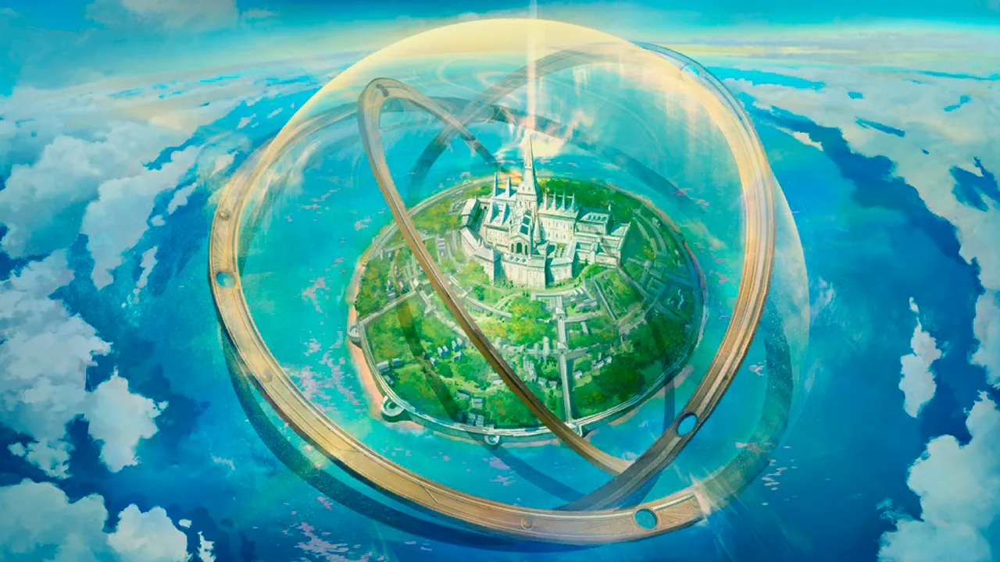
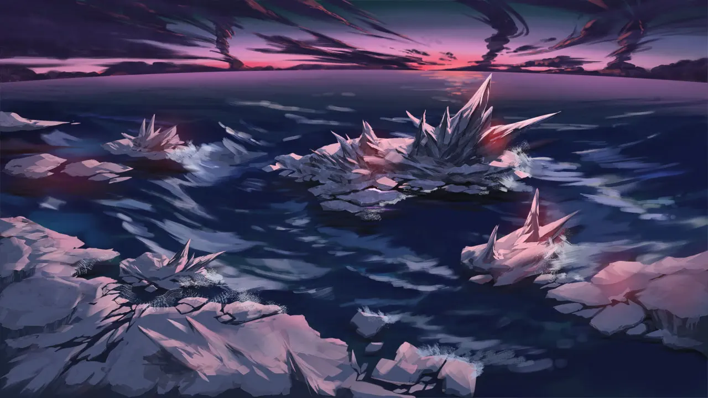
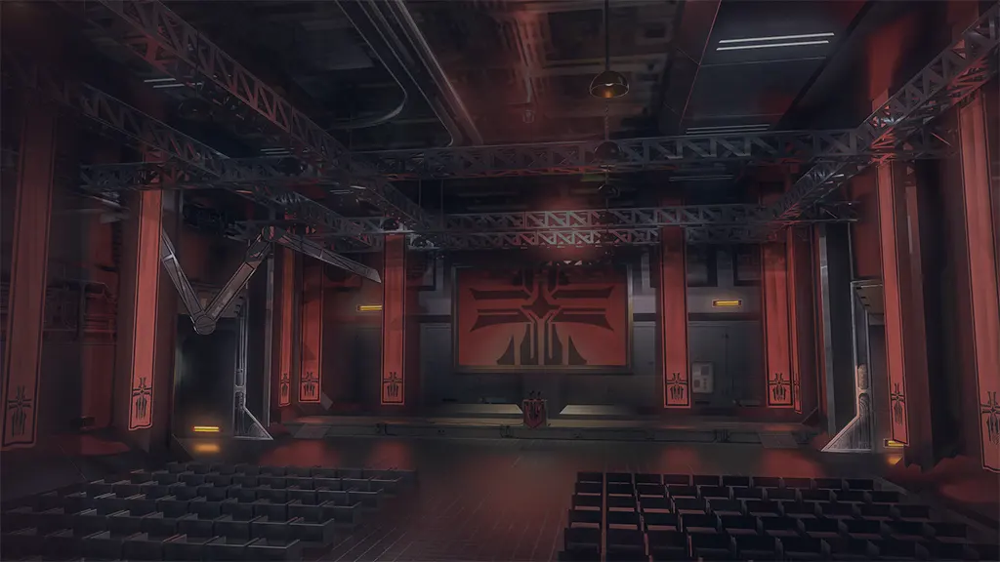
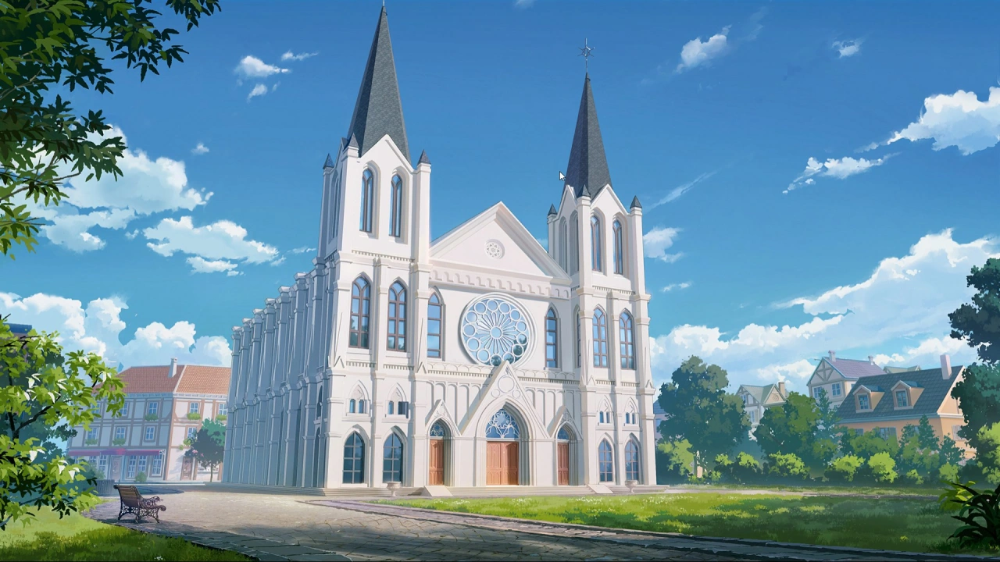
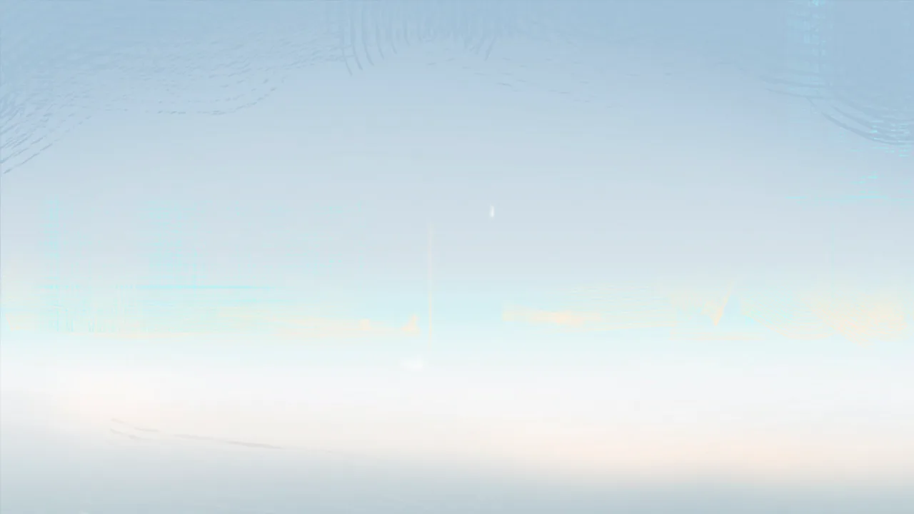
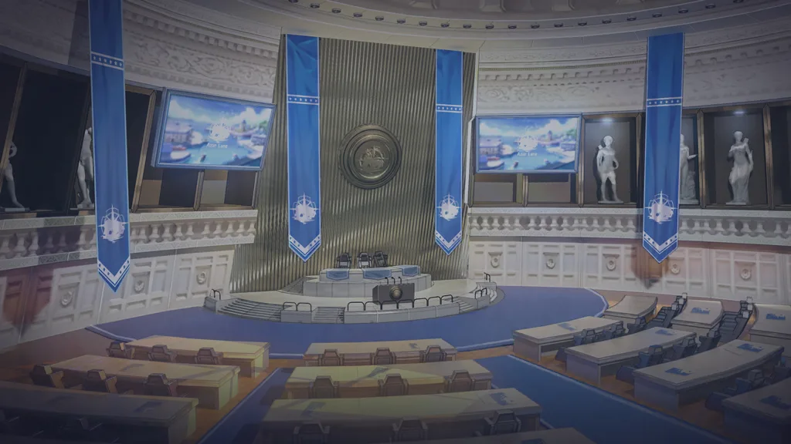
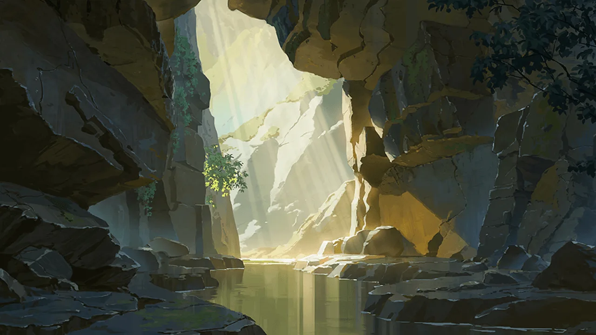
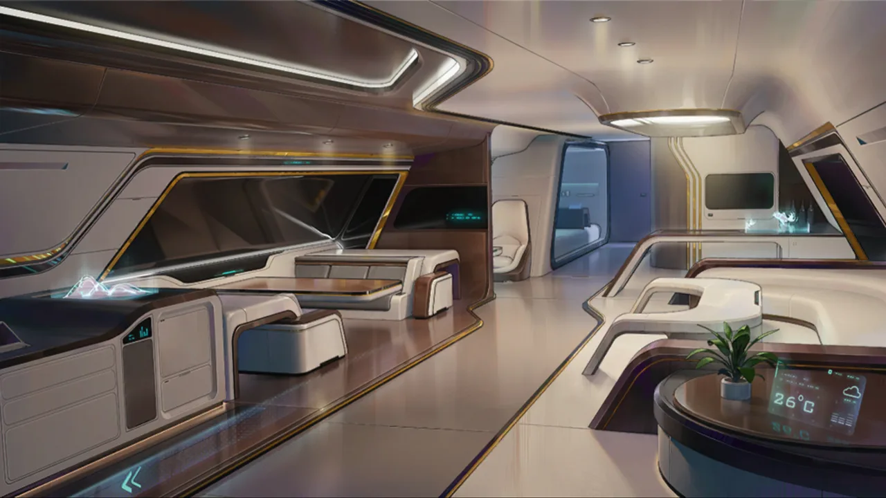

 <!-- начало главы -->

Сон — В память о битве

















 <!-- конец главы -->

 <!-- начало главы -->

Сон — Пусть прошлое останется в прошлом











 <!-- конец главы -->

 <!-- начало главы -->

Реальность — В святой столице



























 <!-- конец главы -->

 <!-- начало главы -->

Сон — Тщеславие















 <!-- конец главы -->

 <!-- начало главы -->

Реальность — В Союзе Орла





























 <!-- конец главы -->

 <!-- начало главы -->

Реальность — Шторм







 <!-- конец главы -->

 <!-- начало главы -->

Реальность — Решимость лисы-хранительницы











 <!-- конец главы -->

