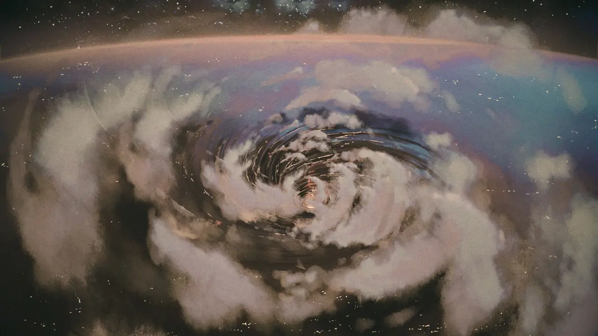

 <!-- начало главы -->

Альтернативные шахматы - Приквел





 <!-- конец главы -->

 <!-- начало главы -->

Разработка 1




 <!-- конец главы -->

 <!-- начало главы -->

Фланг 1




 <!-- конец главы -->

 <!-- начало главы -->

Разработка 2




 <!-- конец главы -->

 <!-- начало главы -->

Инициатива 1




 <!-- конец главы -->

 <!-- начало главы -->

Инициатива 2





 <!-- конец главы -->

 <!-- начало главы -->

Повышение 1




 <!-- конец главы -->

 <!-- начало главы -->

Повышение 2





 <!-- конец главы -->

 <!-- начало главы -->

Альтернативные шахматы - Сиквел




 <!-- конец главы -->

 <!-- начало главы -->

Транспозиция 1




 <!-- конец главы -->

 <!-- начало главы -->

Транспозиция 2




 <!-- конец главы -->

 <!-- начало главы -->

Отклонение 1




 <!-- конец главы -->

 <!-- начало главы -->

Отклонение 2





 <!-- конец главы -->

 <!-- начало главы -->

Перегрузка 1




 <!-- конец главы -->

 <!-- начало главы -->

Перегрузка 2





 <!-- конец главы -->

 <!-- начало главы -->

Шах и Мат 1




 <!-- конец главы -->

 <!-- начало главы -->

Шах и Мат 2




 <!-- конец главы -->

 <!-- начало главы -->

Фланг 2




 <!-- конец главы -->

 <!-- начало главы -->

Шах и Мат 3





 <!-- конец главы -->

