
 <!-- начало главы -->

Сон музыканта




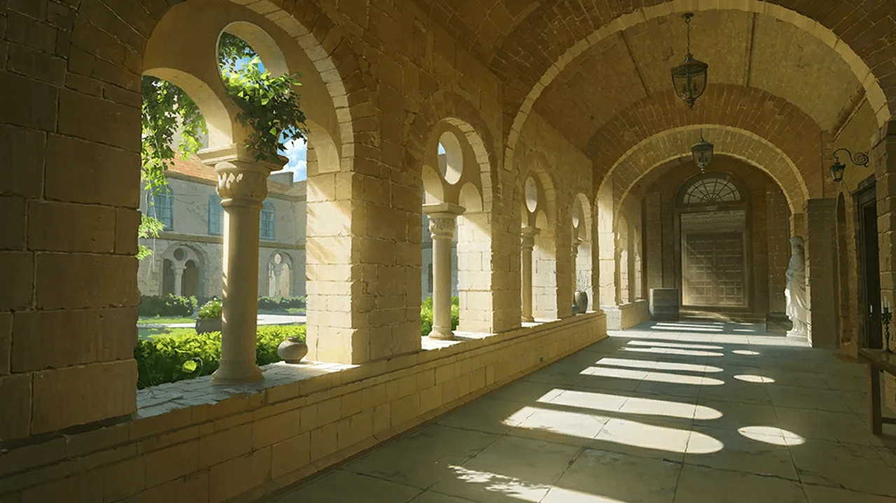



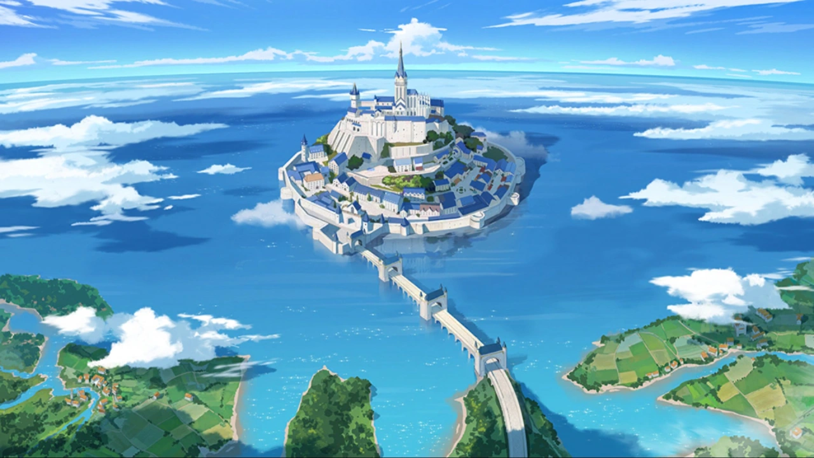






 <!-- конец главы -->

 <!-- начало главы -->

Официальное приглашение


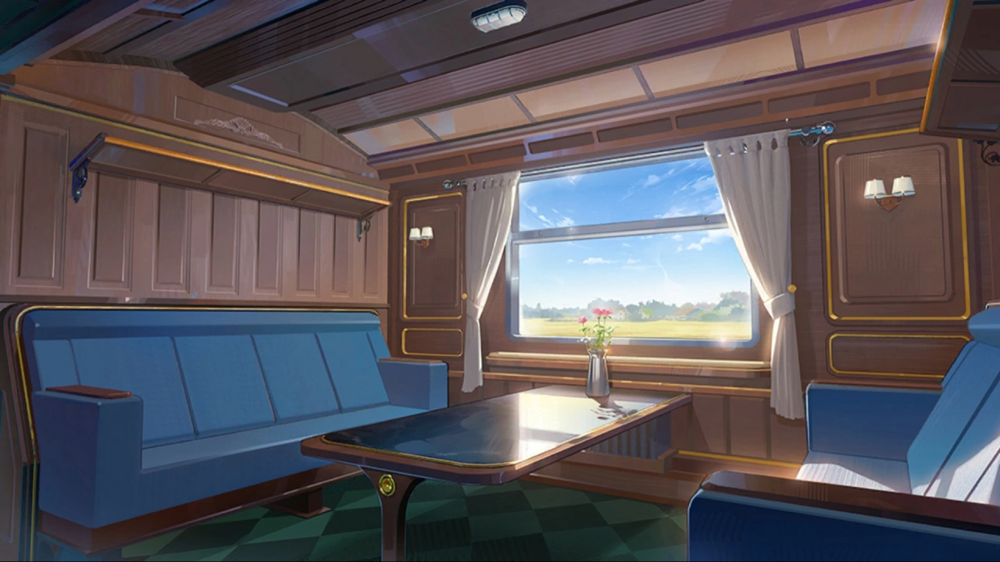




    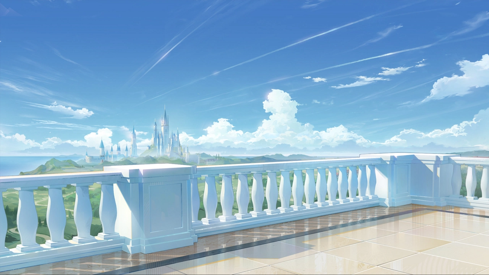
    










 <!-- конец главы -->

 <!-- начало главы -->

Непринуждённый обед



















 <!-- конец главы -->

 <!-- начало главы -->

Мирная Интерлюдия
























 <!-- конец главы -->

 <!-- начало главы -->

Лицом к лицу


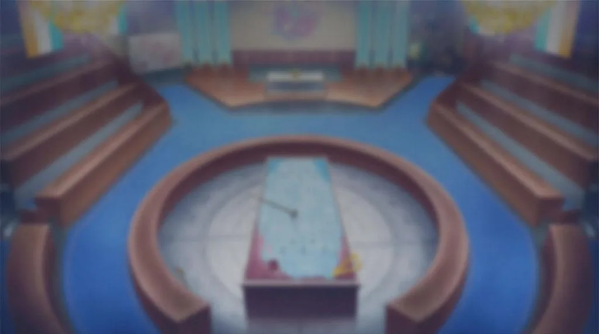



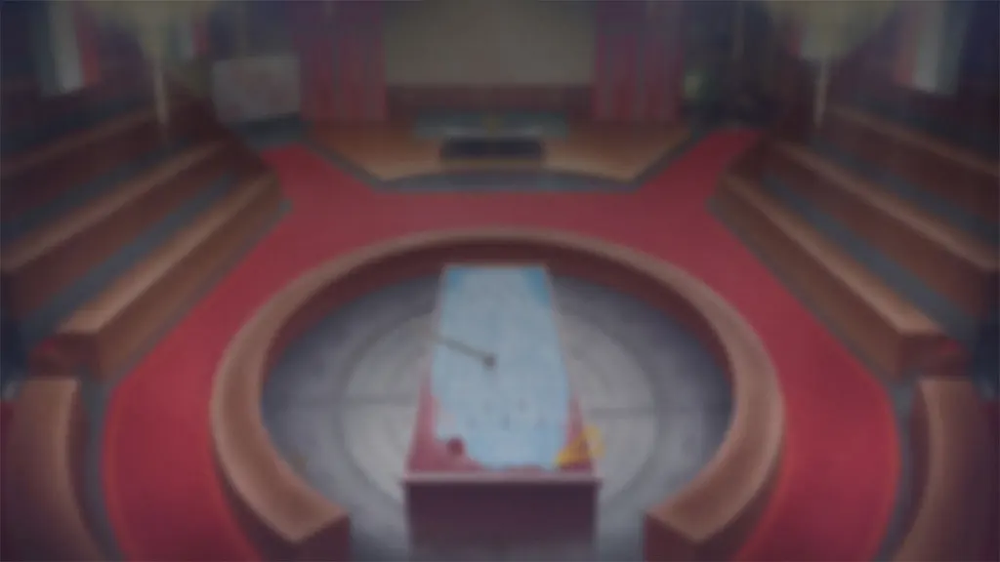











 <!-- конец главы -->

 <!-- начало главы -->

Музыка в ночи


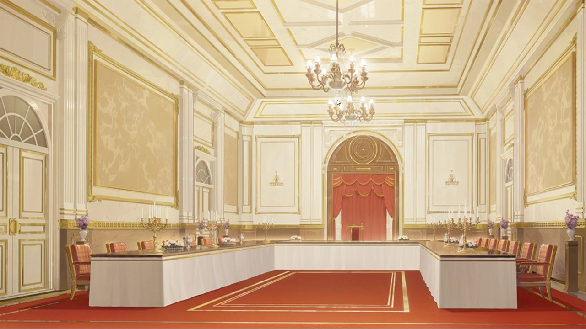


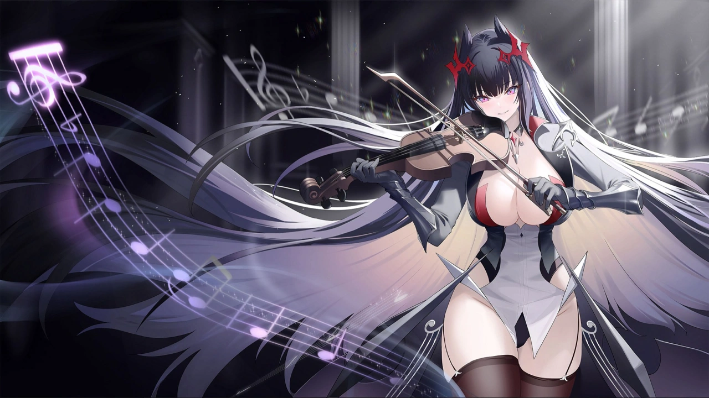















 <!-- конец главы -->

 <!-- начало главы -->

Секрет Базилики















 <!-- конец главы -->

 <!-- начало главы -->

ЕЁ сон

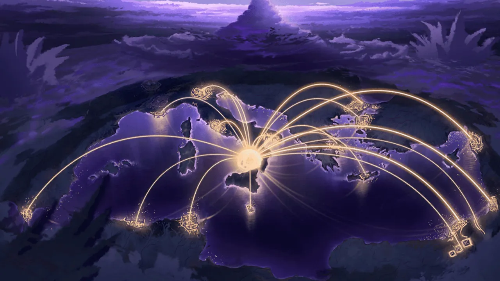






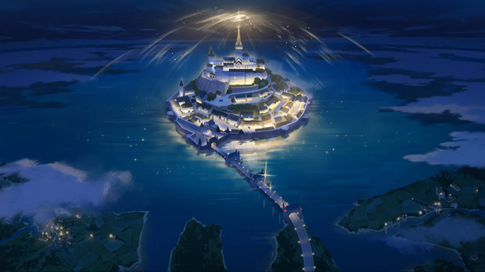



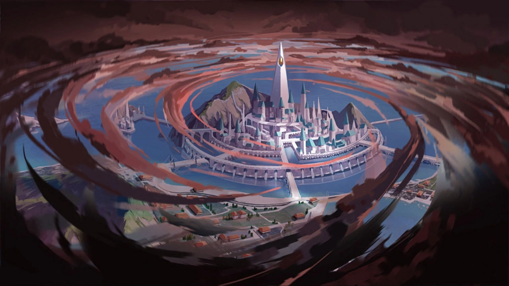


















 <!-- конец главы -->

 <!-- начало главы -->

Прекрасный день





































 <!-- конец главы -->

 <!-- начало главы -->

Ещё один прекрасный день




































 <!-- конец главы -->

