
 <!-- начало главы -->

Спираль памяти

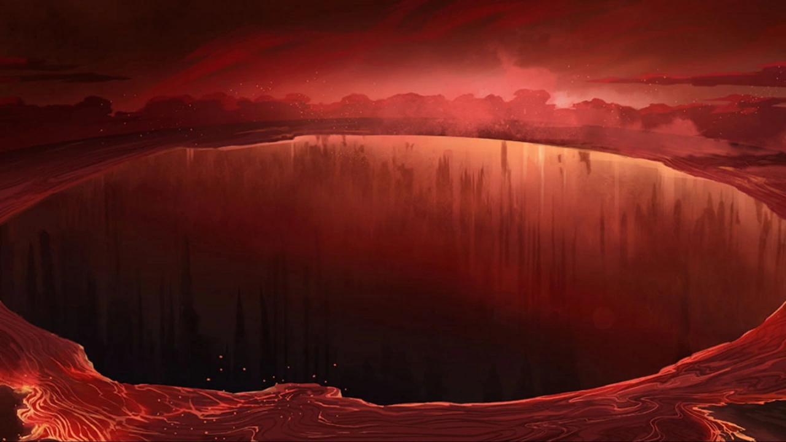



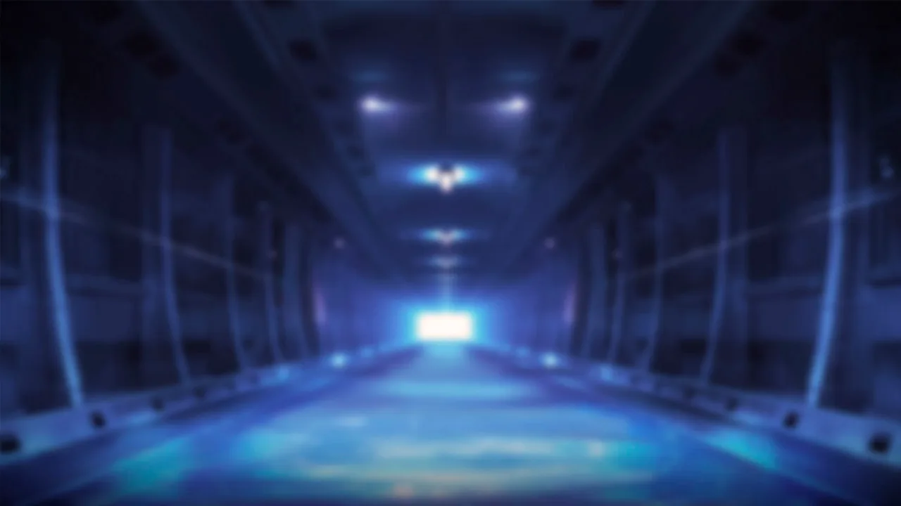







    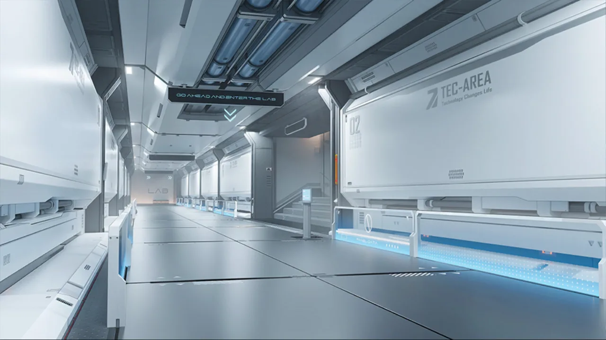
    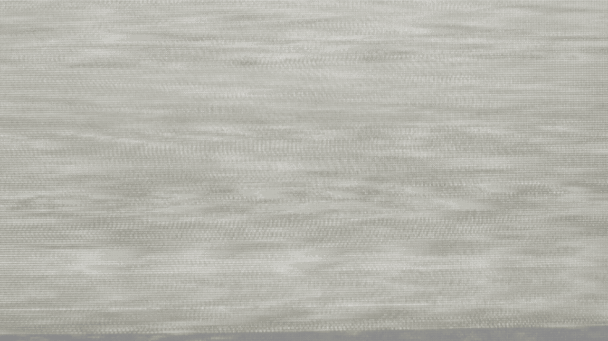





    
    





    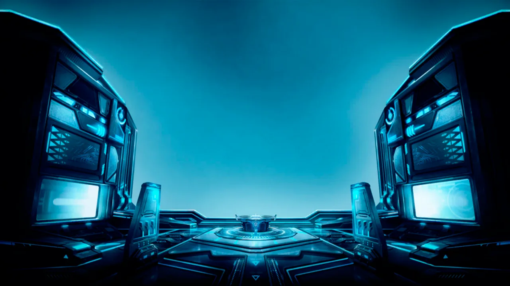
    





    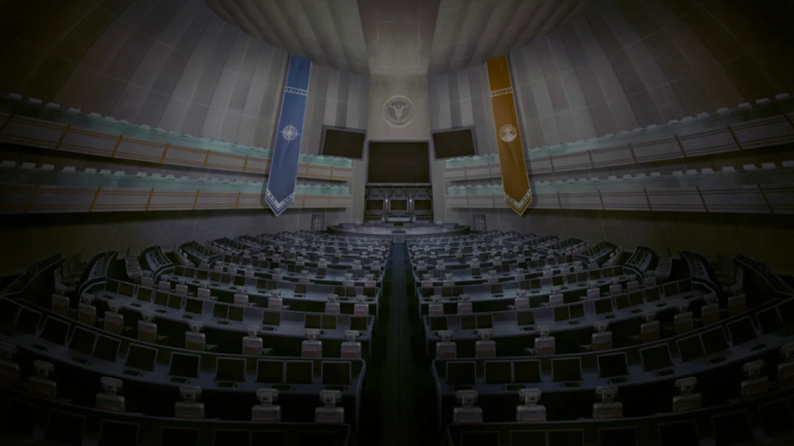
    





    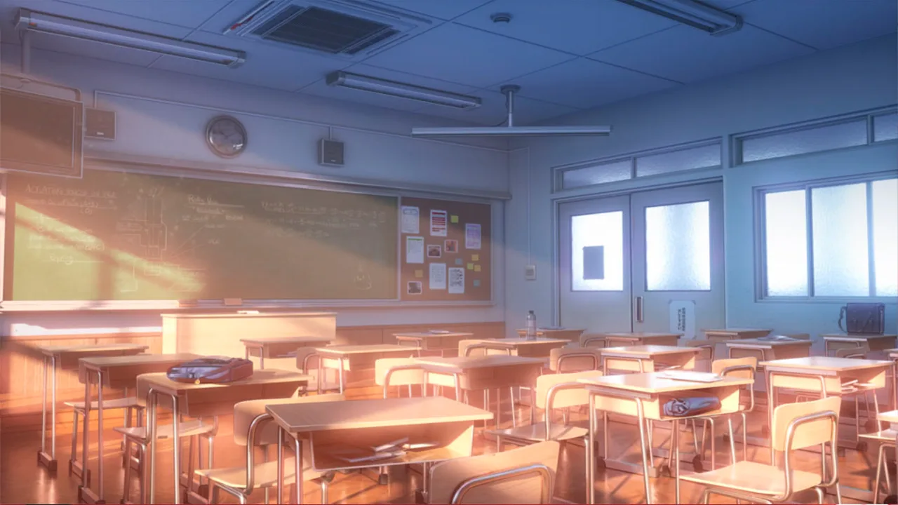
    





    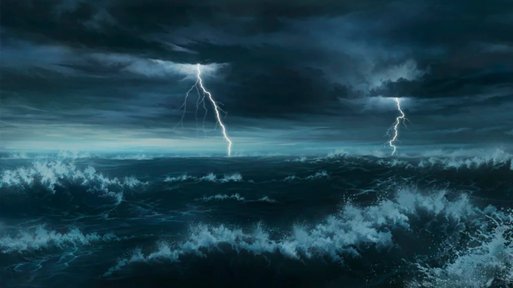
    














 <!-- конец главы -->

 <!-- начало главы -->

План Дворца Дракона

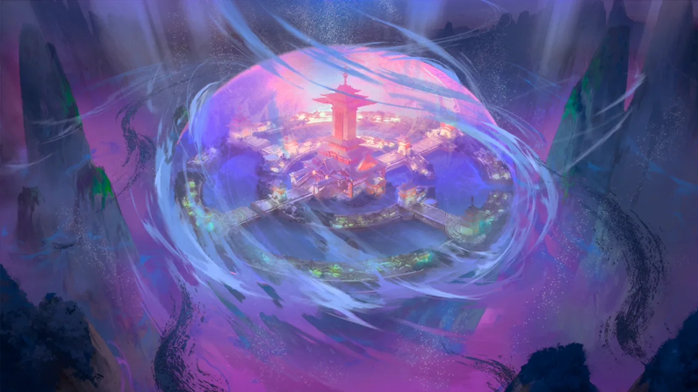






 <!-- конец главы -->

 <!-- начало главы -->

Диссоциация









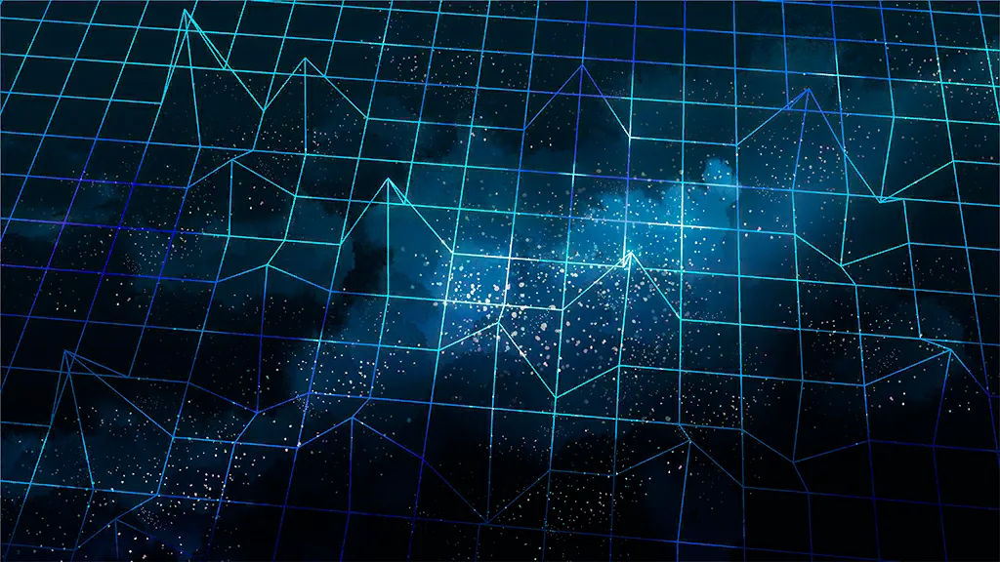










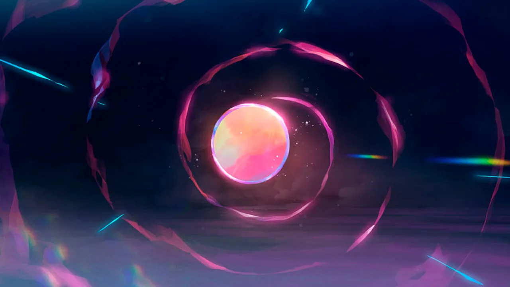




 <!-- конец главы -->

 <!-- начало главы -->

Помощь с другого берега

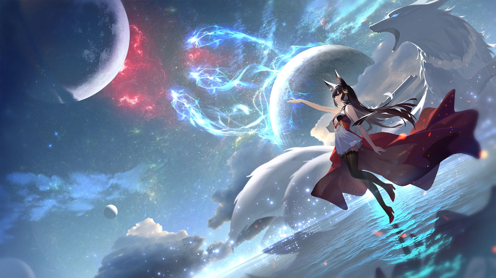



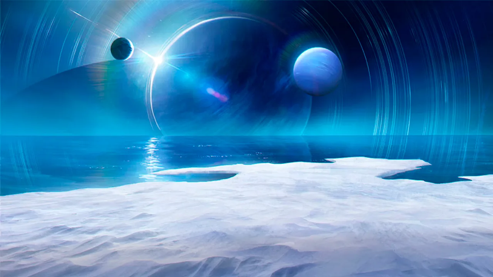









 <!-- конец главы -->

 <!-- начало главы -->

Третий удар













    
    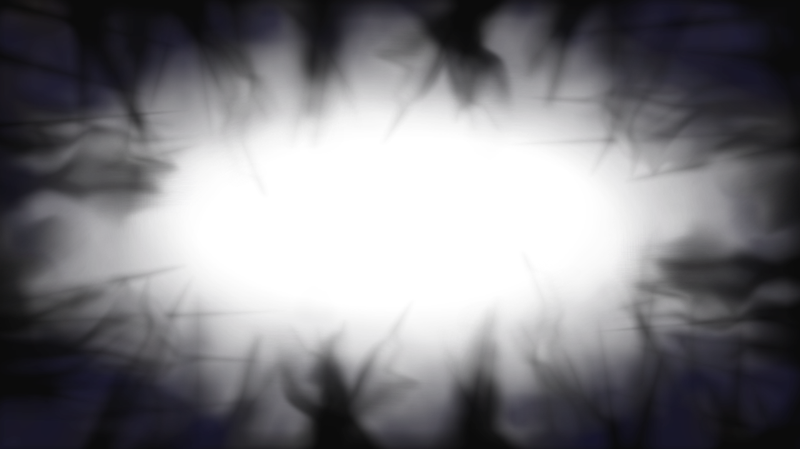
















 <!-- конец главы -->

 <!-- начало главы -->

Мадам М

















 <!-- конец главы -->

 <!-- начало главы -->

Вечно пылающее пламя




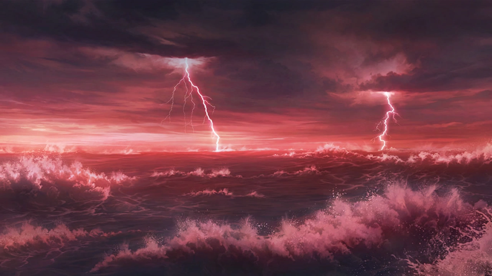













 <!-- конец главы -->

 <!-- начало главы -->

Предзнаменование несовместимости


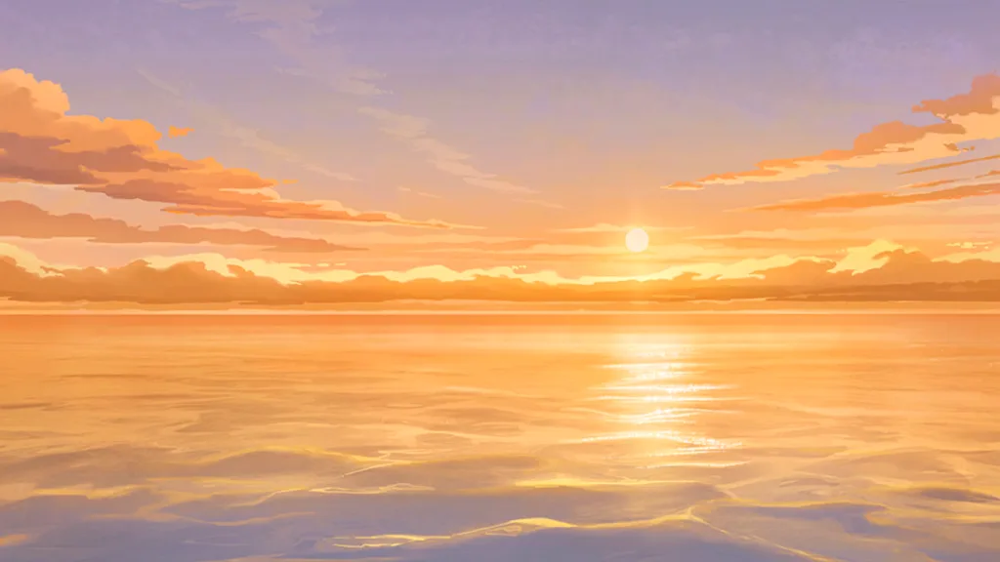


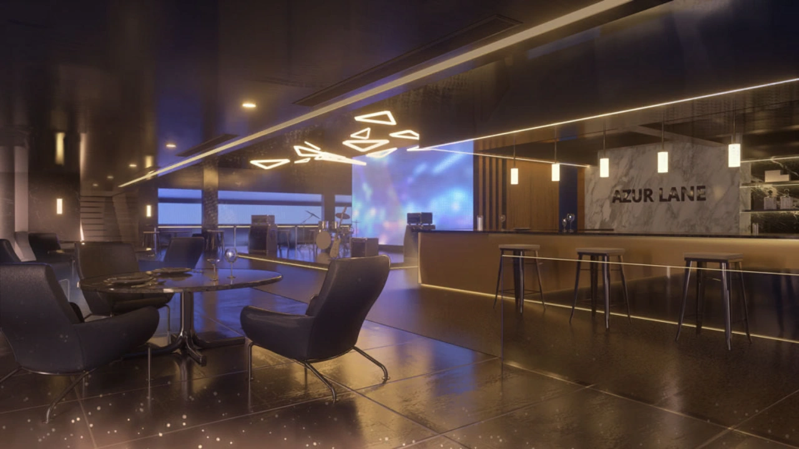














 <!-- конец главы -->

 <!-- начало главы -->

Направленное создание


















 <!-- конец главы -->

