
 <!-- начало главы -->

Отбытие лисы-хранительницы


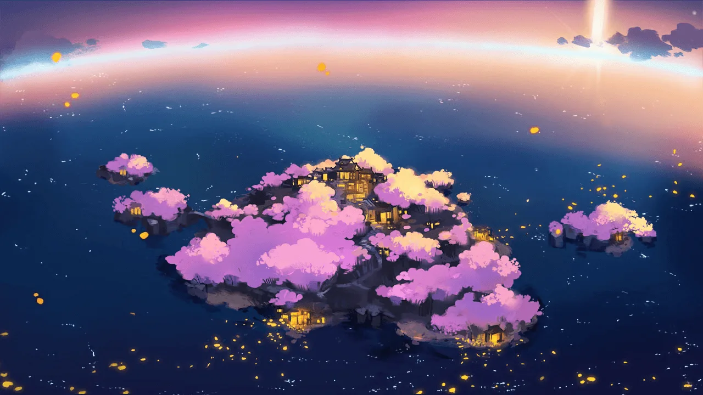



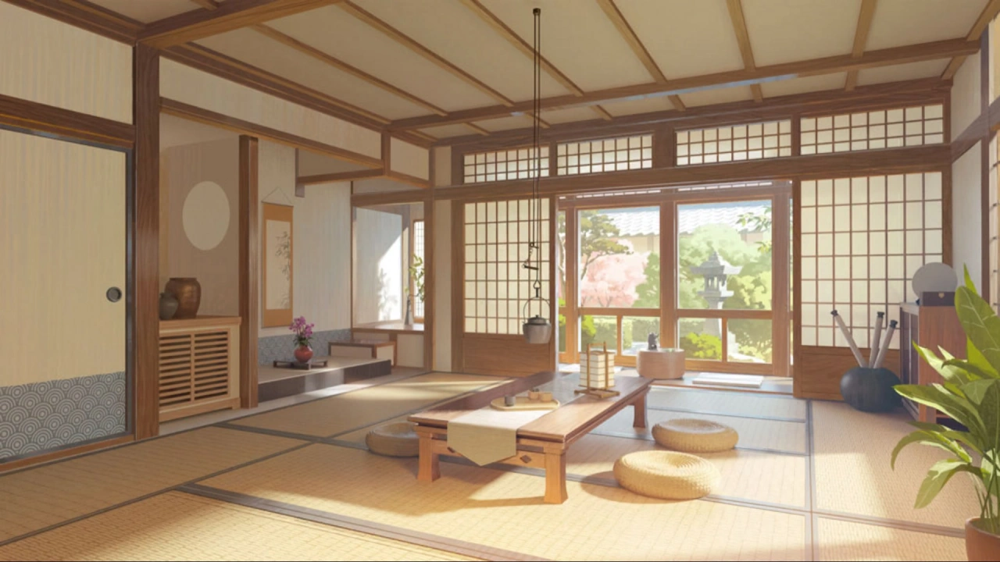











 <!-- конец главы -->

 <!-- начало главы -->

По следам в горах




























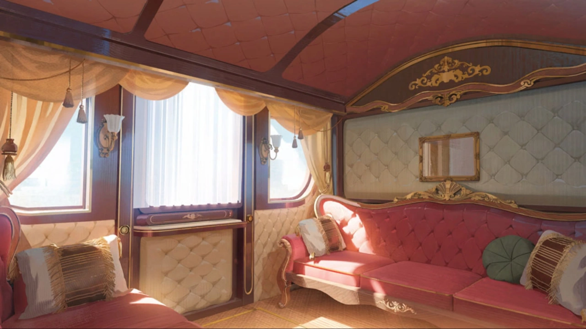





 <!-- конец главы -->

 <!-- начало главы -->

Изначальный Барьер



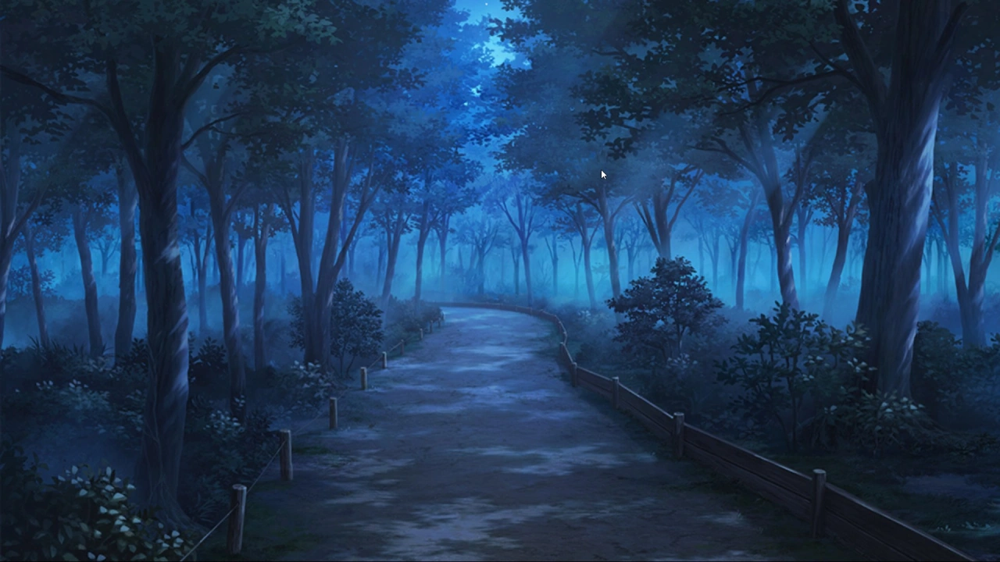
















 <!-- конец главы -->

 <!-- начало главы -->

Запятнанный чернилами сон

















 <!-- конец главы -->

 <!-- начало главы -->

Грядёт Несчастье















 <!-- конец главы -->

 <!-- начало главы -->

Одержимость, уходящая корнями в прошлое


















 <!-- конец главы -->

 <!-- начало главы -->

Планирование вмешательства




































 <!-- конец главы -->

 <!-- начало главы -->

Решающее Оружие











 <!-- конец главы -->

 <!-- начало главы -->

Отступление















 <!-- конец главы -->

 <!-- начало главы -->

Рассеивающий гром

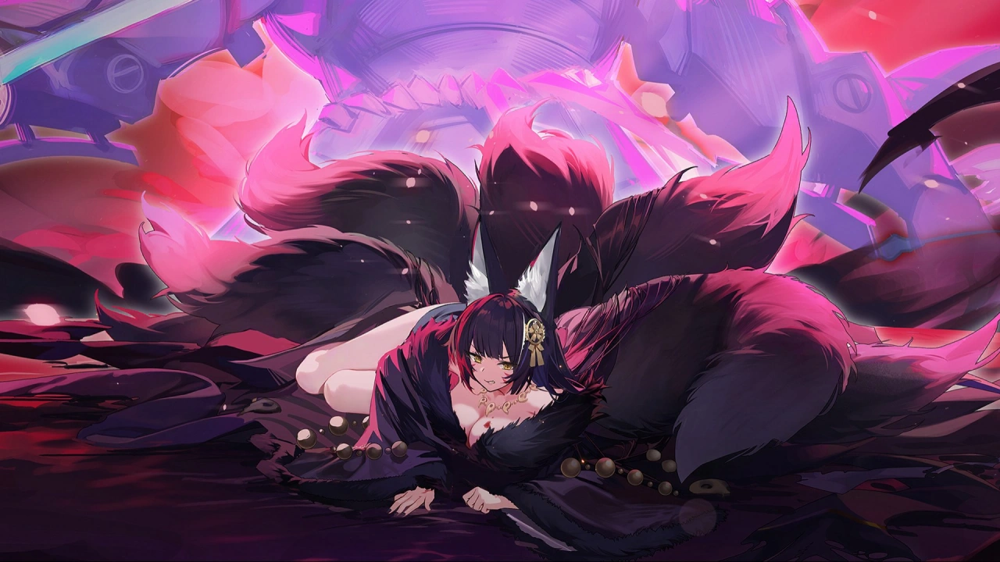




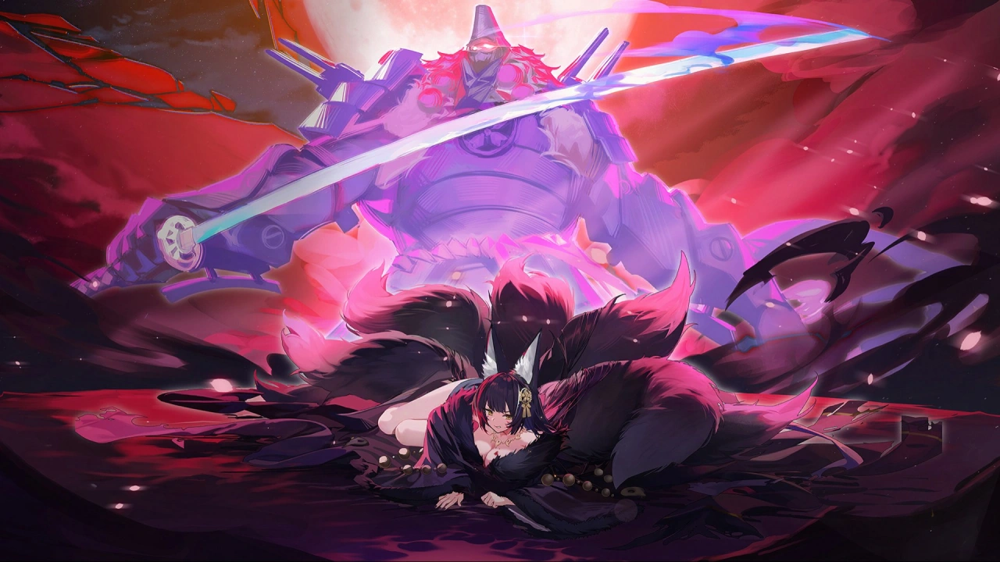



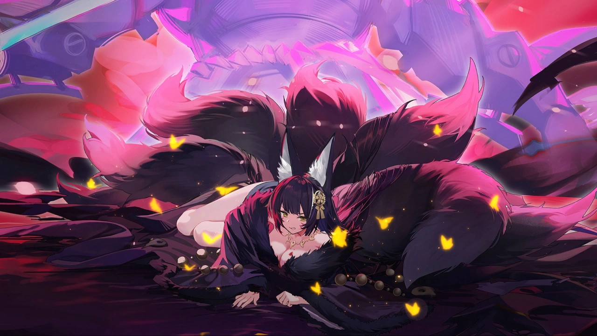






 <!-- конец главы -->

 <!-- начало главы -->

Вверенная воля


















 <!-- конец главы -->

 <!-- начало главы -->

Опавшие лепестки




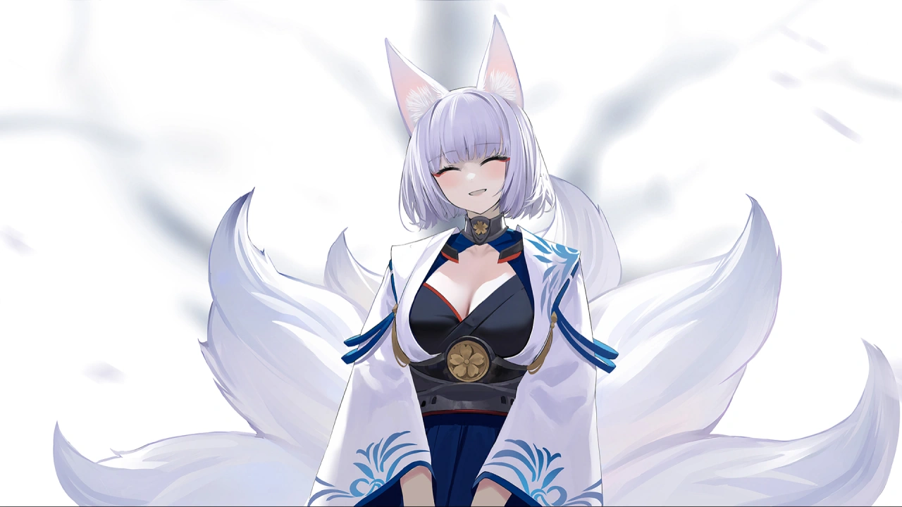


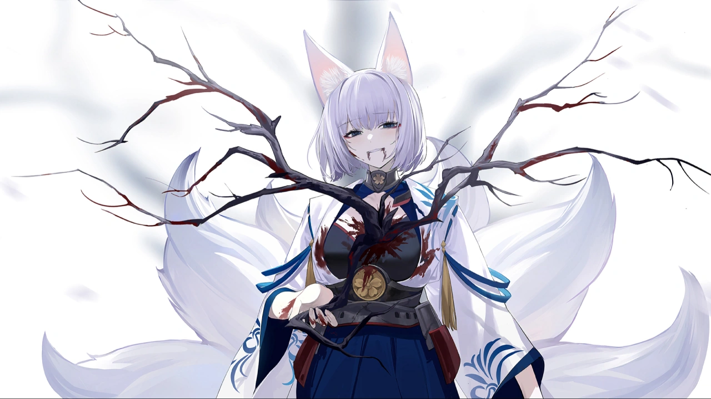


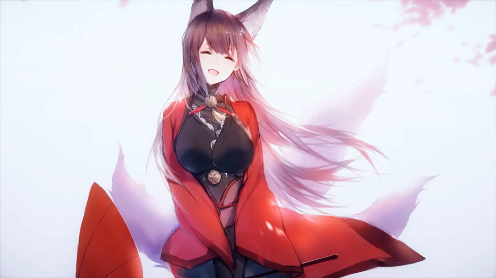



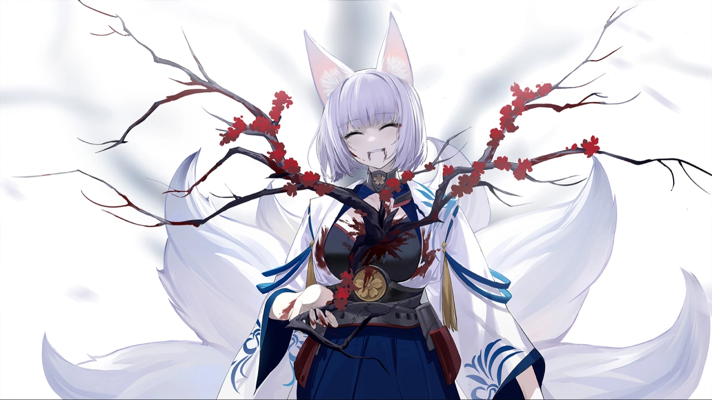





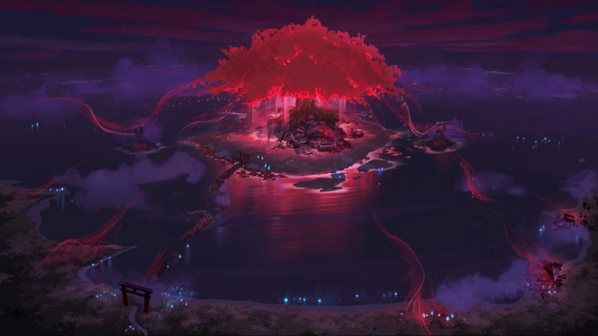



 <!-- конец главы -->

 <!-- начало главы -->

Наш Командир









 <!-- конец главы -->

