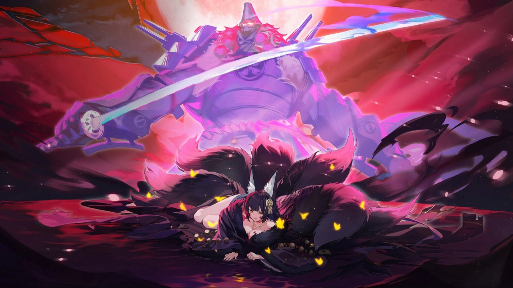
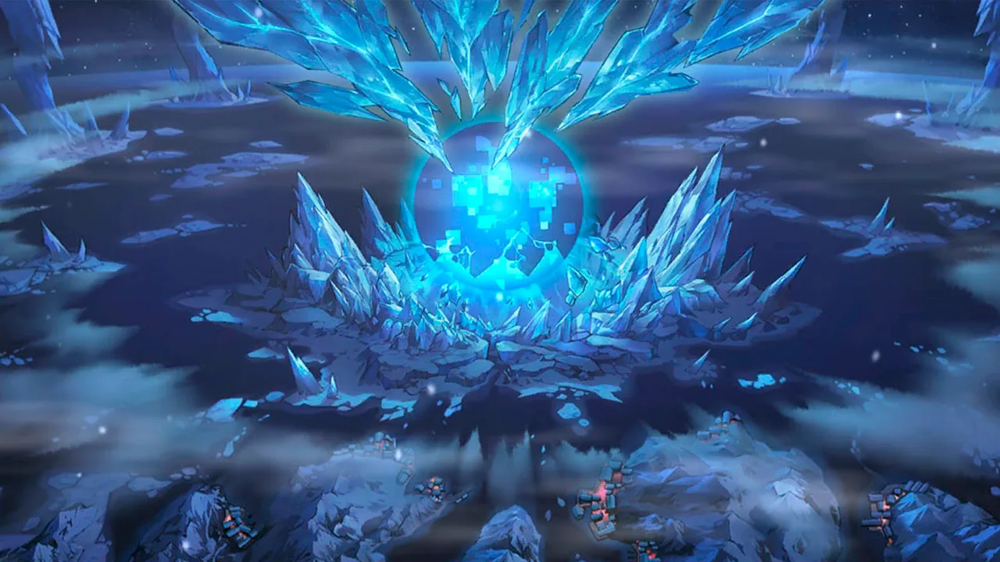
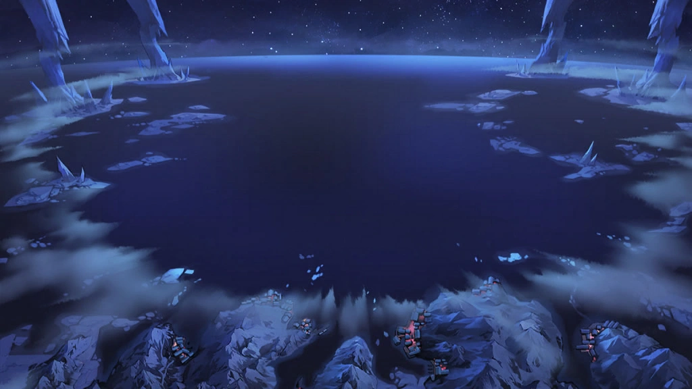
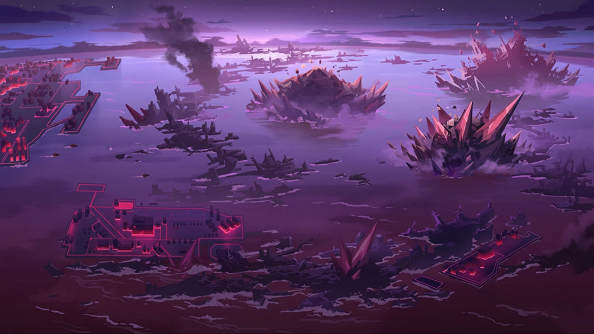

 <!-- начало главы -->

Сингулярность на горизонте























 <!-- конец главы -->

 <!-- начало главы -->

Куда пропал Камелот
















 <!-- конец главы -->

 <!-- начало главы -->

Аномалия высшего порядка








 <!-- конец главы -->

 <!-- начало главы -->

Надежда































 <!-- конец главы -->

 <!-- начало главы -->

Таяние Зимней Короны


















 <!-- конец главы -->

 <!-- начало главы -->

Потрясение











 <!-- конец главы -->

 <!-- начало главы -->

Планы и цели
















 <!-- конец главы -->

